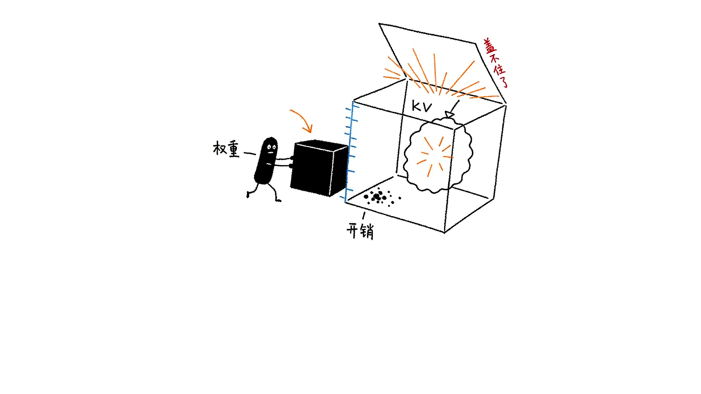
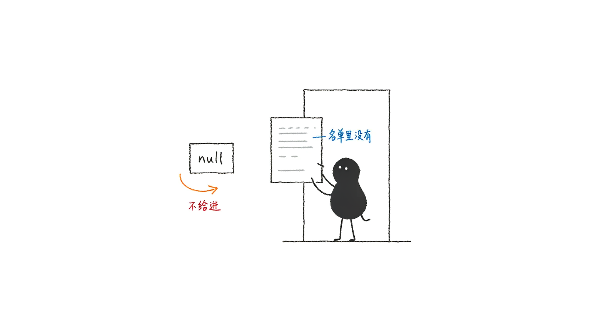

# Ollama 模型看板

> 一个单文件网页，把本机 Ollama 的模型摊开看清楚：**占多少磁盘、吃多少显存、能跑多快、能力如何**。

打开就能看到每个模型的体积、量化等级、架构参数、官方 benchmark 分数，以及在本机的实测生成速度。不装依赖、不起后端、不动 Ollama 配置 —— 一个 HTML 文件加一个双击脚本。

**English TL;DR** — A zero-dependency single-file dashboard for your local [Ollama](https://ollama.com) models. Shows model sizes, VRAM requirements (weights + KV cache), official benchmark scores, and real measured inference speed. Requires opening via a local HTTP server (not `file://`) due to Ollama's CORS allowlist.

---

## 为什么需要它

`ollama list` 只告诉你名字和大小。但装模型时真正要回答的问题是：

- 这 20 个模型一共占了多少磁盘？哪个最占地方？
- **这个 30B 模型我的显卡装得下吗？** 装不下会怎样？
- 同一台机器上，哪个模型实际跑得最快？
- 标着 "coder" 的模型，代码能力到底比通用的强多少？

这些信息散落在文件系统、显存监控、官方博客和评测榜单里。这个小工具把它们收在一页。


---

<!--
  界面截图位置：如需放一张真实界面截图，保存为 docs/screenshot.png，
  然后取消下面那行的注释。正文配图已使用 assets/ 下的小黑插画。
-->
<!--  -->

## 功能

### 模型总览

表格 + 卡片双视图，支持搜索、多列排序、按架构家族 / 参数量 / 量化等级 / 能力 / 显存适配筛选。

- **磁盘占用分布条**：每个模型一段，按体积排序，一眼看出谁最占地方，点一下即可定位
- **精确字节数**：`ollama list` 只给到 GB 级别，这里给出精确到字节的原始值
- **一键复制** `ollama run <model>` 命令

### 显存需求评估 ⭐

这是核心功能。为每个模型算出「装进显存需要多少」并对照你的显卡判断能否装下：

```
权重占用   4.36 GiB      ← 取自 GGUF 文件实际大小
KV cache   0.22 GiB      ← 按 4096 上下文 + 架构参数推算
运行时开销  0.22 GiB      ← 按权重 5% 估算
─────────────────────
合计需求   4.80 GiB      占 16 GiB 显卡的 30%  → 充裕
```

- **三态判定**：`充裕` / `勉强` / `溢出`，配色区分
- **溢出会说明后果**：超出多少 GiB、会回落到系统内存、速度下降多少
- **上下文影响图**：KV cache 随上下文线性增长，抽屉里给出 2K → 128K 各档位的需求曲线，超出显卡容量的档位标红
- **MoE 与 GQA 正确处理**：见下方[实现讲解](#显存是怎么算的)



### 能力数据

内置各模型**官方公开发布**的 benchmark 分数（HumanEval / MBPP / LiveCodeBench / MMLU / GPQA / GSM8K 等）。

**没有编造数据。** 查不到官方来源的一律显示「未收录」，不猜、不用同系列其他尺寸的分数顶替。每条数据都附来源链接和口径说明。


对几个常见的坑做了明确标注：

| 坑 | 处理方式 |
|---|---|
| base / instruct 分数混用 | 官方只公布 base 版时不拿来填 instruct 版 |
| MBPP vs MBPP+（EvalPlus） | 是不同口径，只有 MBPP+ 时 MBPP 留空 |
| MATH-500 vs MATH | 不同基准，不混用 |
| LiveCodeBench 版本差异 | 各家评测区间不同，标注「不可直接横比」 |
| 社区修改版（如 abliteration） | 权重已改动，不借用原版分数 |

### 本机实测

点一下真的调用本机 Ollama 跑分，测出：

- **TTFT**（首 token 延迟，含模型加载时间）
- **生成吞吐**（tokens/s）
- **Prompt 处理速度**

固定提示词、`temperature=0`、`seed=42`、预热 1 次后跑 3 次取中位数。结果存在浏览器里，刷新不丢。

**严格串行执行** —— Ollama 对生成请求本就是串行调度，并发测速只会互相拖慢并污染数据。

### 详情抽屉

点任意模型展开：架构参数（层数、注意力头、上下文长度、MoE 专家数）、能力标签、量化精度分布、许可证全文、digest、显存构成明细。

### 管理操作

删除模型（需键入完整模型名二次确认）、从官方仓库拉取新模型（带分片进度、可中断）。

---

## 快速开始

### 前置要求

- 已安装并运行 [Ollama](https://ollama.com/download)（默认 `127.0.0.1:11434`）
- Python 3 或 Node.js 之一（用于起一个本地静态服务）

### Windows

双击 `start-board.bat` 即可。脚本会自动找可用端口、启动服务、打开浏览器，关掉窗口就停服。

### macOS / Linux

```bash
# 任选其一
python3 -m http.server 5173 --bind 127.0.0.1
npx serve . -l 5173
```

然后访问 <http://127.0.0.1:5173/ollama-model-board.html>

> ⚠️ **不要直接双击 HTML 文件打开。** 必须通过上面的 http 地址访问，原因见[为什么必须走 http](#为什么必须走-http-而不能直接双击)。

---

## 显卡配置

浏览器出于安全限制无法读取本机显卡型号，所以需要**手动填写一次**：

点右上角 ⚙ 设置 → 填写型号与显存容量。内置常见型号速查（RTX 40/30 系、A 系列、Apple 统一内存），点一下就填好。配置存在浏览器 localStorage，下次自动读取。

不填也能用 —— 只是不显示适配判断，显存需求数字照常给出。

---

## 数据口径与免责

这个工具尽量做到**每个数字都能追溯来源**：

| 数据 | 来源 | 性质 |
|---|---|---|
| 模型体积 | `/api/tags` 的 `size` | **权威值**，即 GGUF 文件实际字节数 |
| 架构参数 | `/api/show` 的 `model_info` | **权威值**，来自模型元数据 |
| KV cache | 由架构参数按公式推算 | **理论估算** |
| 显存需求合计 | 权重 + KV + 5% 开销 | **理论估算** |
| 官方 benchmark | 各模型官方发布页 / 论文 | 真实数据，标注来源 |
| 生成速度 | `/api/generate` 实测 | **实测值** |

**关于估算**：显存数字是理论值。实际占用会受显卡驱动版本、量化 kernel 实现、`num_ctx` 设置、是否启用 flash attention 等因素影响。要拿准确值，加载模型后看 `nvidia-smi`。

**关于 benchmark**：官方分数对应上游原始权重版本，本机跑的是量化版本（Q4_K_M 等），实际表现可能有差异，仅作横向参考。

---

## 实现讲解

### 显存是怎么算的

显存占用 = **权重** + **KV cache** + **运行时开销**。

**权重**直接用 `/api/tags` 返回的 `size`，不需要换算。注意**参数量 ≠ 权重字节数**：`gpt-oss:20b` 有 20.9B 参数，但 MXFP4 量化后权重只有 12.8 GiB。

**KV cache** 由架构参数推算：

```
KV bytes = 2 × layers × kv_heads × head_dim × ctx × bytes_per_element
             ↑
          K 和 V 各一份
```

其中：

```
head_dim = attention.key_length ?? floor(embedding_length / head_count)
kv_heads = attention.head_count_kv ?? attention.head_count
bytes_per_element = 2   (Ollama 的 KV cache 用 F16)
```

有两个必须注意的点，写错会差好几倍：

**① GQA 模型必须用 `head_count_kv`，不能用 `head_count`。**

以 `qwen2.5-coder:7b` 为例，它有 28 个注意力头，但只有 4 个 KV 头（Grouped Query Attention）。用 4 算，32K 上下文下 KV cache 是 1.75 GiB；误用 28 会算成 12.25 GiB —— **恰好高估 7 倍**，本来能跑的模型会被误判成装不下。

**② 有显式 `key_length` 时不要用 `embedding ÷ heads` 推算。**

`gpt-oss:20b` 的 `key_length` 是 64，但 `2880 / 64 = 45`，两者不等。优先用元数据里的显式值。

**运行时开销**按权重的 5% 估算，覆盖 CUDA context、计算缓冲区等。这是个经验系数，不是精确值。

**适配阈值定在 90% 而不是 100%**：显存还要分给驱动、桌面合成器、浏览器本身。实测一台 16 GB 显卡在空闲桌面状态下已被系统占用 5.4 GiB，留 10% 余量其实不算宽裕。

### 速度是怎么测的

调 `/api/generate` 流式接口，用固定提示词生成。

- **TTFT** = 从发出请求到收到第一个非空 `response` chunk 的时间（客户端 `performance.now()` 测量），包含模型加载
- **吞吐** = `eval_count / (eval_duration / 1e9)`，用服务端返回的纳秒级计时，不受网络分块影响

**预热是必须的。** 实测冷启动时 `qwen2.5-coder:1.5b` 的 TTFT 是 1724 ms，其中 1707 ms 全是模型加载；预热后 TTFT 降到 110 ms。不预热测出来的全是加载时间。

串行测两次的稳定性：331.1 与 331.5 tokens/s，相差 0.1%。

### 为什么必须走 http 而不能直接双击

Ollama 的 CORS 策略是**白名单**，不是全放行。实测各 Origin 的响应：

| Origin | 结果 |
|---|---|
| `http://localhost:5173` | ✅ 200 |
| `http://127.0.0.1:5173` | ✅ 200 |
| **`Origin: null`** | ❌ **403** |
| `http://localhost.evil.com` | ❌ 403 |

而浏览器从 `file://` 页面发起跨域请求时，发送的 Origin 头正是 `null`。所以双击打开必然被拦，**这是协议层面的限制，无法用代码绕过**。

用本地 http 服务打开后 Origin 变成 `http://127.0.0.1:5173`，在白名单内，一切正常。

（另一种办法是设置环境变量 `OLLAMA_ORIGINS="*"` 永久放行，但需要重启 Ollama，不如直接起个静态服务省事。）



### 关于 `/api/ps` 的显存字段

`/api/ps` 返回的 `size_vram` **不能用来做显存占用统计**。实测：加载 7B 模型后它仍显示着 1.5B 模型的数据，而此时 `nvidia-smi` 显示占用已从 5472 MiB 涨到 7002 MiB。

本项目中该字段**仅用于判断模型是否驻留**，不作为占用数值展示。

---

## 项目结构

```
.
├── ollama-model-board.html   # 主程序（单文件，全部 CSS/JS 内联）
├── start-board.bat           # Windows 一键启动
└── verify-*.js               # 自检脚本（可选，见下）
```

整个应用没有任何外部依赖：不引 CDN、不用外部字体、不需要构建步骤。改完保存刷新即可。

---

## 自检脚本

四个 Node 脚本，改动代码后可以跑一遍确认没坏：

| 脚本 | 检查内容 | 依赖 |
|---|---|---|
| `verify-vram.js` | 显存公式、GQA 正确性、边界降级（52 项断言） | 无 |
| `verify-render.js` | 用真实数据驱动渲染函数，检查输出 HTML | 需 Ollama |
| `verify-api.js` | 流式解析、TTFT、tokens/s 计算（20 项断言） | 需 Ollama |
| `verify-bat.js` | 启动脚本静态检查（不执行 bat） | 无 |

```bash
node verify-vram.js
node verify-render.js
```

其中 `verify-vram.js` 专门断言了「误用 `head_count` 会高估 7 倍」这个 bug —— 一旦有人改坏 GQA 逻辑，测试会立刻失败。

---

## 常见问题

**打开后显示「浏览器跨域限制」**
没走 http。用 `start-board.bat` 或手动起静态服务，别双击 HTML。

**显示「无法连接 Ollama」**
Ollama 没启动。执行 `ollama serve`，或检查托盘图标。

**显存适配显示「未配置」**
点右上角设置填显卡型号和容量。

**实测速度比预期慢很多**
先看是不是溢出到 CPU 了（适配列显示「溢出」）。如果显存够，检查是否有其他程序在占 GPU，或模型是否被系统换出。

**某个模型的 benchmark 显示「未收录」**
说明没找到该模型官方公开发布的分数。这是刻意设计的 —— 宁可显示缺失，也不填一个看起来合理的假数字。

**能看远程 Ollama 吗**
可以。设置里把 API 地址改成 `http://<ip>:11434`，但需要对方设置 `OLLAMA_HOST=0.0.0.0` 并放行对应 Origin。

---

## License

MIT
